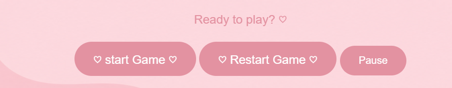
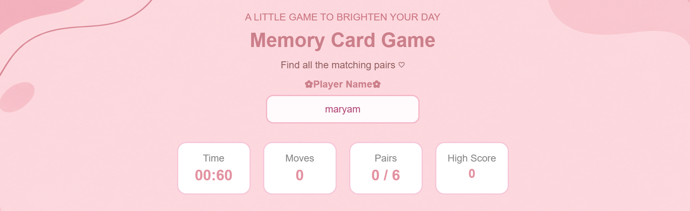
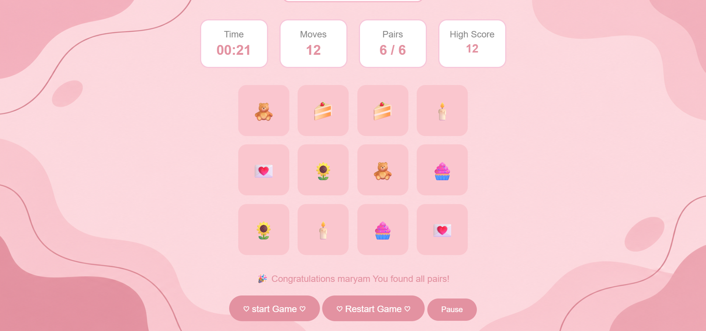

# Memory Card Game

## technolgies used 
1. html 
2. css
3. javascript

## overview
memory card game is a simple and interactive game where playes filp cards to the matching pairs . the game designed with a cute pink theme and helps players improve their memory and concentration .

## user stories 

1. As a user, I want to flip cards so that I can reveal the emojis.
2. As a user, I want to find matching pairs so that I can complete the game.
3. As a user, I want to see the number of moves so that I can track my performance.
4. As a user, I want to see my progress so that I know how many pairs I have matched.
5. As a user, I want to restart the game so that I can play again.
6. As a user, I want the cards to be shuffled each time I start a new game so that every game feels different.
7. As a user, I want to see a winning message when I match all the pairs so that I know I have completed the game.
8. As a user , I want to puase the game for a while then continoue 
9. As a user , I want to see the time that takes me to finsh the game 
10. As a user ,I need to be able to change the theme to dark mode smoothly

## screenshots 

## Future Enhancements
1. animation background
2. puase button
3. save the best score 
4. player name 
5. timer
6. move count
7. winning message 
8. dark mode 